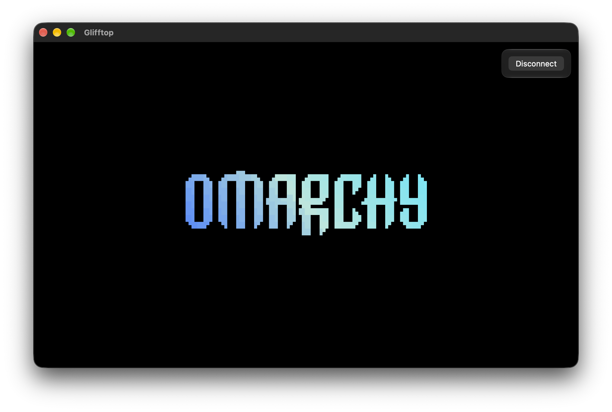
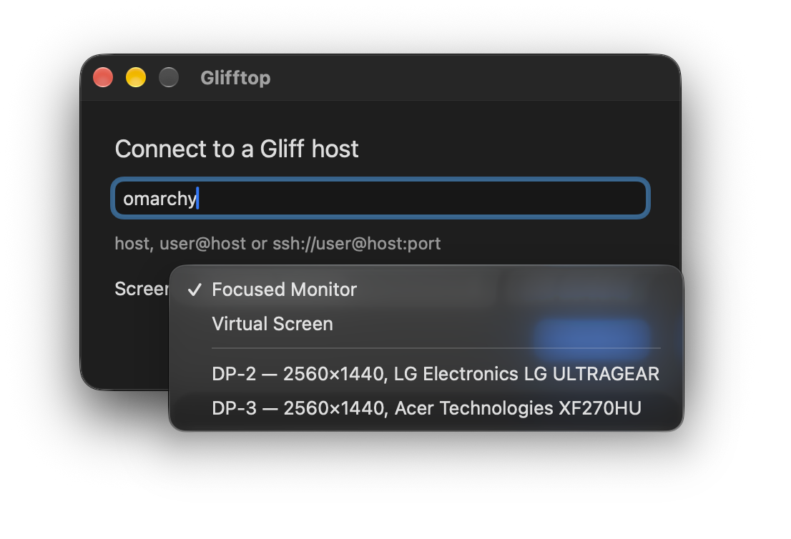

# Glifftop

**An unofficial native Mac client for [Gliff](https://github.com/omacom/gliff)**, the
remote desktop for Hyprland and Omarchy. Not affiliated with the Gliff project.

Glifftop connects over ssh to a machine running the stock `gliff-server` and shows its
desktop in a native macOS window.


The name combines *gliff*, the Scots word for a glimpse, with *desktop* and *clifftop*.

## Status: preview

**Works:**

- Connecting over ssh, with your own ssh config, keys and agent.
- Sharp 4:4:4 colour: H.264 decoded with VideoToolbox and recombined on the GPU.
- Keyboard and pointer capture with your own keyboard layout, and the remote cursor shape.
- Choosing the screen: one of the host's monitors, the focused one, or a virtual screen that
  follows the window's size.
- A shared clipboard (text, HTML and images, both ways), off until you turn it on.
- Saved machines, each with its options, and reconnecting by itself after a lost link.



**Not yet:**

- Files over the clipboard.
- Tabs.
- ⌘Space and ⌘Tab stay with the Mac.
- Signed releases: for now, build it yourself.

**Known, upstream:** Hyprland 0.56.2 shares every cursor image fully transparent, so the
Mac arrow shows over the picture.

## Requirements

- A Mac with Apple silicon and macOS 27. Glifftop supports only the newest major macOS.
- A machine running Hyprland and `gliff-server` 0.4.3, which you can reach with
  `ssh <host>` without a prompt: a key in an ssh agent (such as 1Password's), and the host's
  key already in `~/.ssh/known_hosts`. Glifftop never accepts a new host key.

Tested with gliff-server 0.4.3 and Hyprland 0.56.2 on an NVIDIA RTX 3070 Ti (Vulkan Video
encode).

## Using it

1. Type the ssh destination, as you would after `ssh` (for example `omarchy`, a `Host` in
   your `~/.ssh/config`), pick the screen, and connect. **Get Screens** lists the host's
   monitors.

   
2. While the window is in front, the keyboard and pointer go to the remote computer;
   **Input ▸ Release Input** (⇧Esc) gives them back to the Mac.
3. **View ▸ Actual Size** (⌘0) shows the remote 1:1, turning Scale to Fit off; **View ▸ Scale
   to Fit** (⌥⌘0) scales a smaller screen up.
4. **Settings ▸ Clipboard**, or the clipboard button in the toolbar, shares the clipboard,
   after asking. While Glifftop is in front, what you copy on the Mac goes to the remote
   computer, and its copies come to the Mac. A password manager's copies go only at **Shared,
   including passwords**. The button steps through Not shared (grey), Shared (blue) and
   Shared including passwords (orange, with a key).

## Build

You need Xcode 27.2 and its Metal Toolchain (`xcodebuild -downloadComponent MetalToolchain`,
or Xcode ▸ Settings ▸ Components). Then open `Glifftop.xcodeproj` and run, or:

```sh
xcodebuild -project Glifftop.xcodeproj -scheme Glifftop -configuration Debug \
    -derivedDataPath .build/xcode build
open .build/xcode/Build/Products/Debug/Glifftop.app
```

To run the tests and checks, see [CONTRIBUTING.md](CONTRIBUTING.md).

## Updating upstream

The protocol module is checked against golden fixtures that upstream's own Rust
(`gliff-proto`, pinned by commit in `tools/fake-server/Cargo.toml`) generates.

- `scripts/check-upstream.sh` says whether gliff has released a newer version.
- To adopt one: change the `rev` in `tools/fake-server/Cargo.toml` to that release's commit,
  run `scripts/cargo-net.sh update -p gliff-proto` and
  `scripts/cargo-net.sh fetch --locked`, then `scripts/test.sh`. The fixture drift check
  fails on every encoding that changed: review that diff, regenerate the fixtures (the
  command is in CLAUDE.md), and update the Swift side until the gate passes.

## Security

See [SECURITY.md](SECURITY.md) for what Glifftop trusts and how to report a vulnerability.

## License

MIT; see [LICENSE](LICENSE). Gliff's protocol is © its authors, MIT; see [NOTICE](NOTICE).
